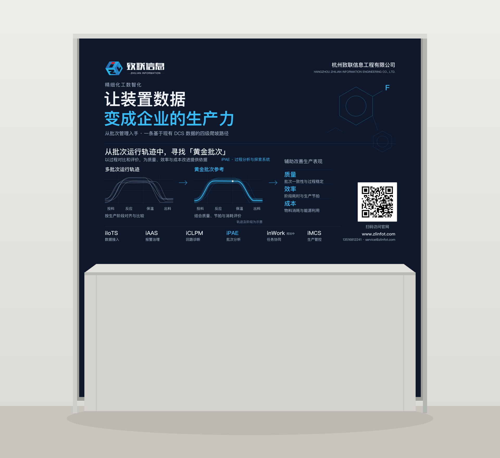
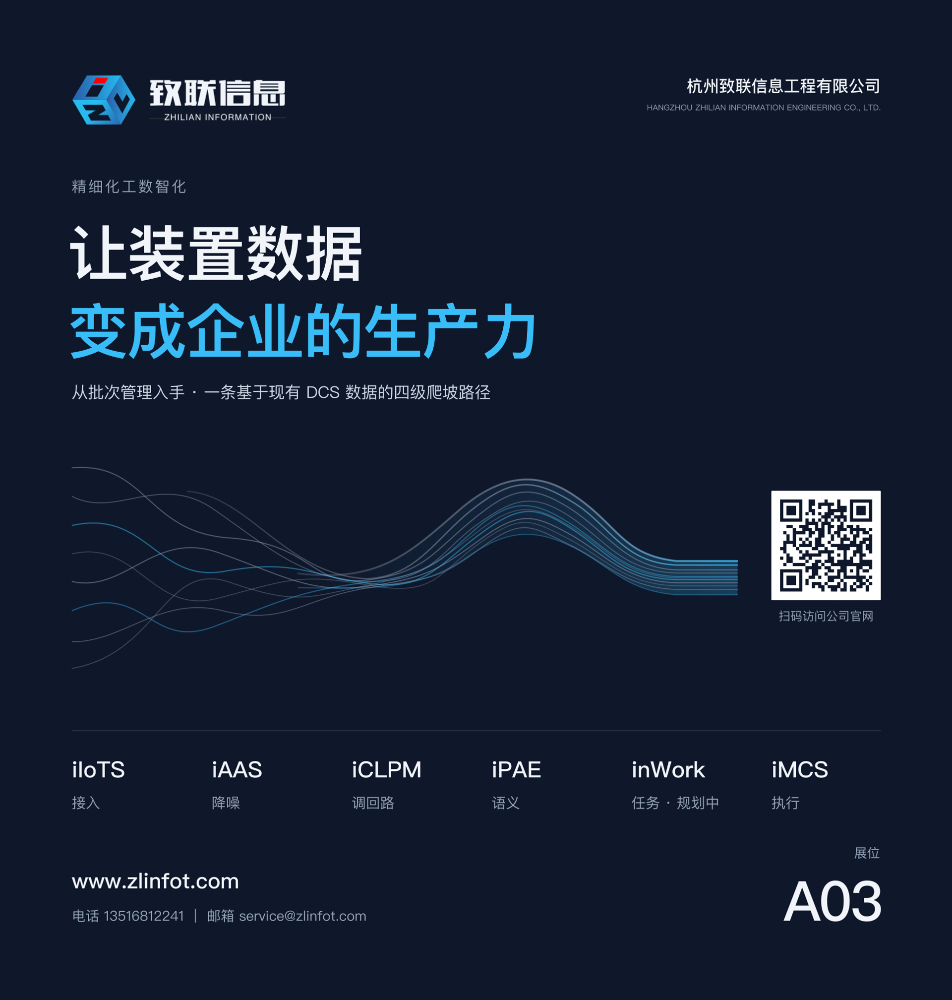

# 精细化工背景板 · 黄金批次与生产力

2026-10-19 第二版效果审阅稿。当前以 **v2** 为准；第一版保留用于对照。



## 第二版设计与文件

主线为「批次运行轨迹 → 寻找黄金批次 → 辅助改善质量、效率与成本」。iPAE 作为核心内容，六款产品在支撑栏保留名称和各自用途。

| 文件 | 用途 |
|---|---|
| `A03-v2-effect-1920.jpg` | 完整正面 RGB 效果图，1920 × 2016 px |
| `A03-v2-placement-review.jpg` | 前方约 0.8 米高桌子的遮挡示意 |
| `A03-v2-layout-editable.svg` | 自包含可编辑源，2060 × 2160 mm，含 30 mm 出血 |
| `design-v2.mjs` | 第二版文案、化学图形、轨迹图与位置定义 |
| `assets/qr-website-http.png` | 编码 `http://www.zlinfot.com` 的 H 级纠错二维码 |

第二版的修改：

- 所有文字、图表和二维码集中在成品上方 1200 mm 内；底部 900 mm 保持纯底色。
- 移除可见的 A03 展位号。
- 加入苯环与含氟分子结构图形，表达精细化工背景；图形为行业意象。
- 放大黄金批次内容：展示多批次轨迹的阶段对齐、黄金批次参考，以及质量、效率、成本评价维度。
- 轨迹和阶段明确标注为示意；未使用客户数据，未给出收益数字。黄金批次需要结合质量、节拍与消耗评价，不能仅凭曲线外观判断。
- 保留 iIoTS / iAAS / iCLPM / iPAE / inWork / iMCS，inWork 标注「规划中」。
- 网址展示为 `www.zlinfot.com`，二维码改用当前能访问的 HTTP 入口；HTTPS 二维码保留在第一版资产中，不用于第二版。

第二版以原生 SVG 绘制，沿用第一版字体、配色与 LOGO；没有重新生成或修改品牌 LOGO。

## 第二版验证与复现

- 构建通过：22 项必需文案、11 个禁用词、1920 × 2016 输出尺寸；正文无 A03。
- 正文坐标限制在板顶 1190 mm 以内；正面和桌前效果图已目视检查。
- macOS Vision 对整板识别出 46 处文字，最低文字距成品底边约 905 mm；未识别到 A03。后续仅将扫码提示改为同位置的「扫码访问官网」。
- macOS CoreImage 对二维码原件和整板 JPEG 均成功解码为 `http://www.zlinfot.com`。
- LOGO 沿用已转曲的 A2 原件。
- 二维码白底卡片 230 mm；码图 194 mm，距成品顶端 860 mm。
- 当前仍为 RGB 效果审阅稿。最终 CMYK、字体转曲及实物小样须在送印前处理。

```bash
npm install
npm run build:finechem
```

可以通过 `A03_SHARP_MODULE` 指向已有 sharp 包目录，免安装重建。本轮使用 macOS PingFang SC。

---

## 第一版留档 · 由散到聚

2026-10-19 效果审阅版。按照最新背景板设计委托书及已定文案制作。



## 设计

深藏青满版底色，两行主标语占据视线黄金区。主视觉以分散的过程曲线汇聚成紧密包络，呼应从装置数据到批次语义的主线。六条产品线集中排在一条横带，二维码保持在便于扫描的高度。

- 主标语：让装置数据 / 变成企业的生产力。
- 副标题：从批次管理入手 · 一条基于现有 DCS 数据的四级爬坡路径。
- 原始 LOGO、二维码按字节复用；主视觉用内置 imagegen 形成构图概念，再绘制为可编辑 SVG 贝塞尔曲线。
- 页面分为品牌、主张、主视觉、二维码、产品线、联系方式六个信息区。
- 未使用客户界面截图、案例数字、坐标图或旧产品代号。

## 文件

| 文件 | 用途 |
|---|---|
| `A03-effect-1920.jpg` | 正面 RGB 效果图，1920 × 2016 px，成品裁切比例 |
| `A03-placement-review.jpg` | 中性背景上的安装示意；板面与正面效果图一致，框架为示意 |
| `A03-layout-editable.svg` | 自包含可编辑源，2060 × 2160 mm，含四周 30 mm 出血 |
| `assets/data-ribbon.svg` | 可编辑矢量主视觉，无位图放大限制 |
| `assets/logo-dark.svg` | 沿用已转曲的 A2 深底版 LOGO |
| `assets/qr-website.png` | 沿用已定官网二维码 |
| `assets/hero-concept.png` | imagegen 原始构图参考；未直接嵌入最终板面 |
| `prompts/hero-concept.md` | 原始生成提示词 |
| `build.mjs` | 重建源文件和两张效果图，并检查必需文案、禁用词、输出尺寸 |

## 本轮核验

| 项目 | 结果 |
|---|---|
| 成品与出血 | 2000 × 2100 mm；四周各 30 mm |
| 关键内容安全边距 | 布局按至少 120 mm 留边；未作印刷出厂验收 |
| 文案 | 17 项必需字符串齐全；六产品顺序与委托书一致 |
| 文本红线 | 构建脚本所列 11 个禁用词无命中；板面已目视检查 |
| LOGO、二维码素材 | SHA-256 与委托素材原件一致 |
| 二维码尺寸 | 图像 220 × 220 mm；白底卡片 230 × 230 mm |
| 二维码位置 | 距成品顶端 1035 mm，符合委托书 800–1200 mm 区域 |
| 二维码解码 | 原件及整板 JPEG 均经 macOS CoreImage 解码为 `https://www.zlinfot.com` |
| 预览尺寸 | 正面 1920 × 2016 px；安装示意 1920 × 1760 px |

当前是 **RGB 效果审阅版**。正文保留可编辑文字；最终字体转曲、印厂 ICC/CMYK 转换、150 dpi 喷绘文件及实物小样属于视觉确认后的送印收口。

官网二维码沿用已定地址；2026-10-19 从当前网络访问该 HTTPS 地址仍连接失败。解码成功只证明二维码内容正确，不证明官网可访问。

## 重建

需要 Node.js 和 `sharp@0.35.5`。本轮使用 macOS 的 PingFang SC 字体；其他机器需提供同字体以保持排版一致。SVG 自带图形素材，不依赖外部图片路径。

```bash
npm install
npm run build
```

也可通过 `A03_SHARP_MODULE` 指向已有的 sharp 包目录，免安装重建。

此提交仅包含本次设计交付物。既有项目材料与旧图稿保留在本地原位置。
